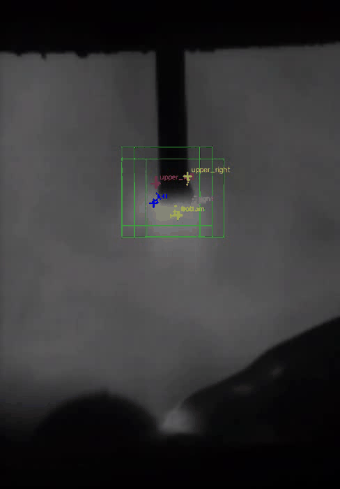
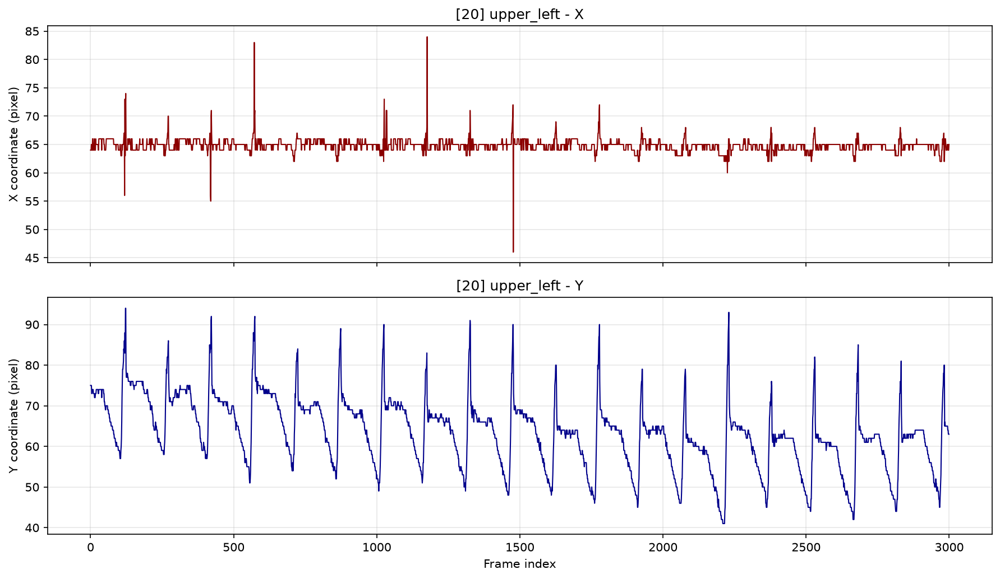
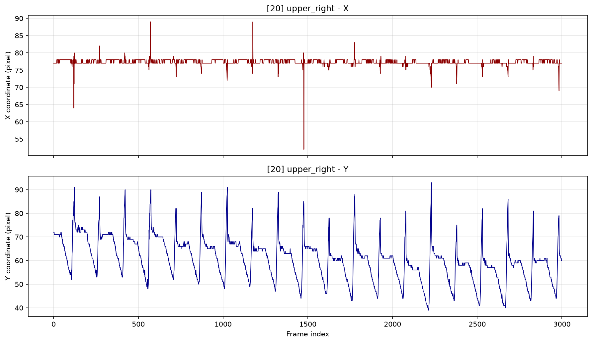
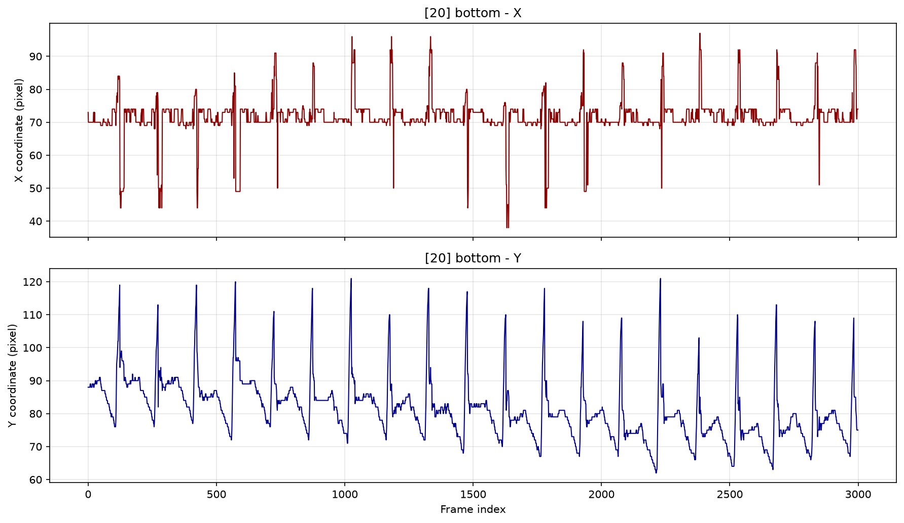
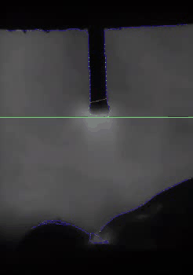
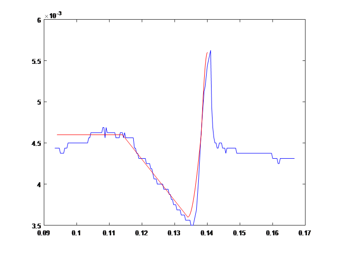

# Welding Droplet Vision

**Computer Vision and Dynamic Modelling of Welding Droplet Transfer**

This repository reconstructs and documents an undergraduate research project on droplet-transfer dynamics in piezoelectric actuator-assisted Gas Metal Arc Welding (GMAW).

The project combines traditional computer vision, convolutional neural networks (CNNs), and theoretical dynamic modelling to detect droplet boundaries in high-speed welding videos, generate displacement curves, and examine the agreement between theoretical predictions and experimental measurements.

## Research Overview

In piezoelectric actuator-assisted GMAW, a piezoelectric actuator periodically clamps and releases the welding wire. The resulting wire deformation and elastic rebound generate transient motion that helps detach droplets from the wire tip.

Understanding this process requires accurate measurements of droplet motion and a physical model describing the transfer cycle. However, intense arc-light interference makes droplet boundaries difficult to detect reliably in high-speed welding images.

This project addresses the problem through three connected components:

- **Traditional computer vision:** C++ and OpenCV-based image processing, contour reconstruction, and boundary detection.
- **Deep learning:** CNN-based image-window classification and boundary-coordinate regression.
- **Dynamic modelling:** A four-stage theoretical model of droplet transfer, with a piecewise displacement function for comparison against experimentally detected trajectories.

## Research Workflow

```text
High-speed Welding Videos
           |
           v
     Frame Extraction
           |
           v
   Sampling and Annotation
           |
           +---------------------------+
           |                           |
           v                           v
 Traditional Computer Vision      Deep Learning
           |                           |
           v                           v
   Boundary Detection          CNN Classification
           |                           |
           |                    CNN Coordinate Regression
           |                           |
           +-------------+-------------+
                         |
                         v
                Displacement Curves
                         |
                         v
              Theoretical Dynamic Model
                         |
                         v
             Model-to-Experiment Comparison
```

## Methods

### Traditional Computer Vision

The original image-processing approach includes:

1. Grayscale conversion and Gaussian filtering.
2. Canny edge detection.
3. Contour reconstruction to address fragmented, missing, and redundant edges.
4. Detection of the droplet's upper and lower boundaries.
5. Generation of displacement curves from detected coordinates.

The original research reported that this approach was sensitive to arc-light interference and produced noisy displacement curves.

The repository preserves the C++ source code and historical result files. The current archived implementation has not been fully verified under the modern OpenCV 5 environment.

### Deep Learning

The deep-learning pipeline uses two types of CNN models:

- A **classification CNN** identifies image windows containing different droplet regions.
- Five **regression CNNs** independently predict the coordinates of the upper-left, upper-right, bottom, left, and right droplet boundaries.

A sliding-window detector combines classification and regression to locate droplet boundaries in full video frames.

The reconstructed implementation uses Python 3.11, PyTorch, and OpenCV. It includes preprocessing, annotation, dataset construction, model training, inference, visualization, and saved model checkpoints.

### Theoretical Dynamic Modelling

The theoretical model describes one droplet-transfer cycle in four stages:

1. Droplet dwelling.
2. Wire energy storage.
3. Wire rebound.
4. Droplet detachment.

The four stages are combined into a piecewise displacement function. The theoretical trajectory can then be compared with the experimentally detected droplet-bottom displacement curve.

The original research reported approximately 90% agreement between the theoretical trajectory and a representative CNN-derived experimental curve. This historical result is distinct from the metrics of the reconstructed PyTorch models.

## Representative Results

The following examples show the reconstructed detection outputs for video `20`.

### Deep-learning detection



Representative boundary displacement curves:

| Boundary    | Plot                                                                |
|-------------|---------------------------------------------------------------------|
| Upper-left  |    |
| Upper-right |  |
| Bottom      |            |

### Traditional-vision detection



The traditional-vision outputs are preserved for comparison. The archived C++ implementation has not been fully verified with OpenCV 5.

### Theoretical Model and Experimental Curve

The original research compared its theoretical displacement model with a representative experimental droplet-bottom trajectory detected by the CNN-based method.



<sub>Historical comparison from the original research. The reported agreement of approximately 90% is not a metric from the current reconstructed PyTorch training run.</sub>

## Repository Structure

```text
welding-droplet-vision/
├── README.md
├── docs/
│   ├── research_summary.md
│   ├── original_pipeline.md
│   ├── dataset_specification.md
│   ├── model_specification.md
│   └── figures/
│       └── theoretical_model_comparison.png
├── data/
│   ├── README.md
│   ├── metadata/
│   ├── video-samples/
│   └── results/
├── deeplearning/
│   └── README.md
└── traditional-vision/
    └── README.md
```

The `data/` directory contains metadata, video previews, detection outputs, and visualization results. Original video recordings and other large research assets may be distributed separately through GitHub Releases.

## Documentation

| Document                                                  | Description                                                                                                                 |
|-----------------------------------------------------------|-----------------------------------------------------------------------------------------------------------------------------|
| [Research Summary](docs/research_summary.md)              | Research background, objectives, methods, findings, and reconstruction scope                                                |
| [Original Pipeline](docs/original_pipeline.md)            | Original image-processing, CNN, and theoretical modelling workflows                                                         |
| [Dataset Specification](docs/dataset_specification.md)    | Video sources, sampling, annotation, dataset construction, and split strategies                                             |
| [Model Specification](docs/model_specification.md)        | CNN architectures, training configurations, evaluation metrics, and reconstructed results                                   |
| [Deep-learning Module](deeplearning/README.md)            | Environment setup, preprocessing, annotation, training, inference, and checkpoints                                          |
| [Traditional-vision Module](traditional-vision/README.md) | Original image-processing method and archived C++ implementation                                                            |
| [Data Documentation](data/README.md)                      | Data organization, metadata, result files, and download information                                                         |
| [Theoretical Model](docs/theoretical_model.md)            | Four-stage droplet-transfer dynamics, wire deflection analysis, equivalent spring-mass models, and experimental comparison. |


## Reproduction

The deep-learning module provides the main executable workflow:

1. Obtain the original video recordings.
2. Extract and sample video frames.
3. Annotate image windows and boundary coordinates.
4. Build classification and regression datasets.
5. Train the CNN models or load the provided checkpoints.
6. Run sliding-window detection and generate displacement visualizations.

The theoretical model is documented separately and can be used to interpret and compare the resulting droplet-bottom displacement curves.

See the [Deep-learning Module README](deeplearning/README.md) for detailed execution instructions.

## Limitations

- Original experimental videos are distributed separately where redistribution is permitted.
- The regression datasets use sample-based splitting, so samples originating from the same source frame may appear in different subsets.
- The archived traditional-vision C++ implementation has not been fully verified under OpenCV 5.
- The original thesis's approximately 90% theoretical-to-experimental curve agreement is a historical result, not a newly computed metric for all reconstructed videos.
- The reconstructed software and model metrics should not be interpreted as a bit-for-bit reproduction of the original implementation.

## Data and Code Availability

Please refer to the repository license and accompanying data documentation for information about code and research-data availability. Original experimental recordings should only be redistributed where permission has been obtained.
