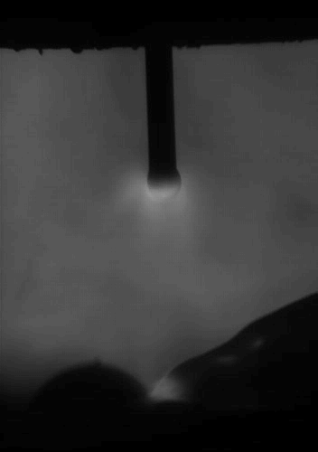
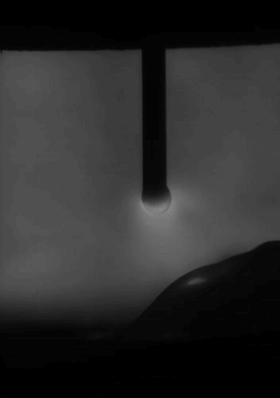
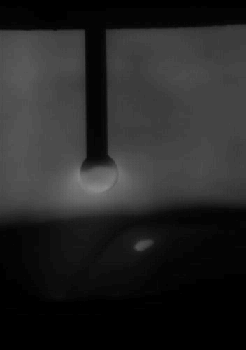
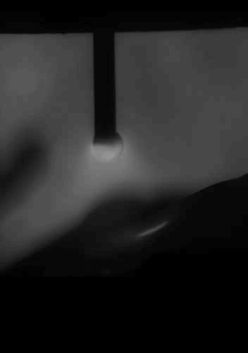
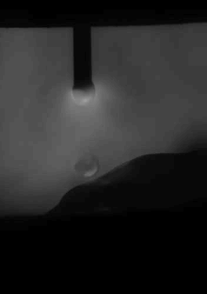
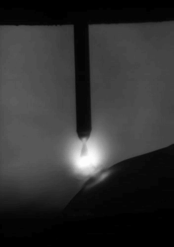
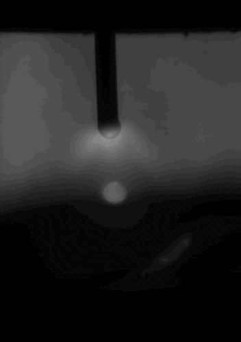

# Research Data

This directory contains representative video samples, annotation metadata, and experimental results generated by the deep learning and traditional computer vision pipelines.

## 1. Data Overview

The project uses seven welding videos for the deep learning pipeline. The traditional computer vision implementation was applied to four of these videos.

| Video ID | Original filename  | Deep Learning | Traditional Vision |
|----------|--------------------|---------------|--------------------|
| 20       | `20_.avi`          | Yes           | Yes                |
| 21       | `21_.avi`          | Yes           | No                 |
| 22       | `22_.avi`          | Yes           | No                 |
| 24c      | `24__clip.wmv`     | Yes           | Yes                |
| 26c      | `26__clip.wmv`     | Yes           | Yes                |
| 29       | `29_.avi`          | Yes           | No                 |
| 33       | `Y4 Camera33_.avi` | Yes           | Yes                |

The video IDs are used consistently throughout the project. For example, `24__clip.wmv` corresponds to video ID `24c`.

The original video recordings used in this project are distributed separately through GitHub Releases to keep the source repository lightweight.

Download the raw video dataset `welding-droplet-vision-raw-videos.zip` from the [GitHub Releases](../../releases) page and extract the video files into the `data/videos/` directory.

GIF previews of the recordings are available in [`data/video-samples/`](../data/video-samples/).

**Note:** The GIF previews are provided for visual reference only.


## 2. Directory Structure

```text
data/
├── metadata/
├── video-samples/
└── results/
    ├── deep-learning/
    └── traditional-vision/
```

## 3. Video Samples

Representative GIF samples generated from the original welding videos are provided below.

| Video | Sample                              |
|-------|-------------------------------------|
| 20    |    |
| 21    |    |
| 22    |    |
| 24c   |  |
| 26c   |  |
| 29    |    |
| 33    |    |

## 4. Metadata and Annotations

The `metadata/` directory contains:

- `videos_info.csv`: Video identifiers and basic recording information.
- `sampling_records.csv`: Mapping between sampled frames and their original video frames.
- `classification_labels.csv`: Manual annotations for the classification task.
- `regression_labels.csv`: Manual boundary-coordinate annotations for the regression task.

## 5. Deep Learning Results

The `results/deep-learning/` directory contains detection results for all seven videos.

Each video directory includes:

- `detection.csv`: Frame-level predicted boundary coordinates.
- `detection.gif`: Representative detection visualization.
- `plots/`: Temporal curves of predicted boundary coordinates.

## 6. Traditional Computer Vision Results

The `results/traditional-vision/` directory contains results for videos 20, 24c, 26c, and 33.

Each video directory includes:

- `detection.csv`: Extracted boundary coordinates.
- `detection.gif`: Representative visualization of the traditional vision pipeline.
- `plots/`: Temporal curves of extracted boundary coordinates.

**Note:** The traditional computer vision source code is preserved for reference. Its execution under modern OpenCV environments has not been fully validated.

## 7. Reproducibility

For details about data preprocessing, annotation, dataset construction, and model training, refer to:

- [Dataset Specification](../docs/dataset_specification.md)
- [Model Specification](../docs/model_specification.md)
- [Deep Learning Pipeline](../deeplearning/README.md)
- [Traditional Vision Implementation](../traditional-vision/README.md)
