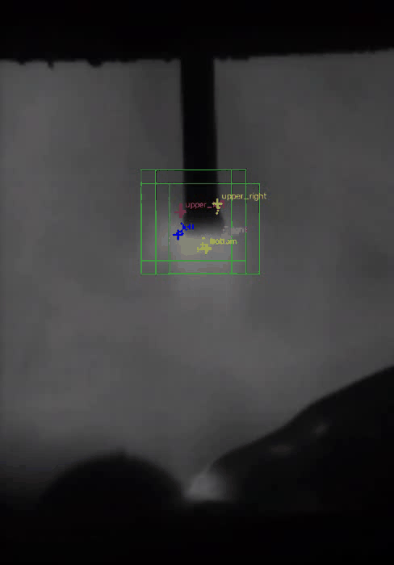
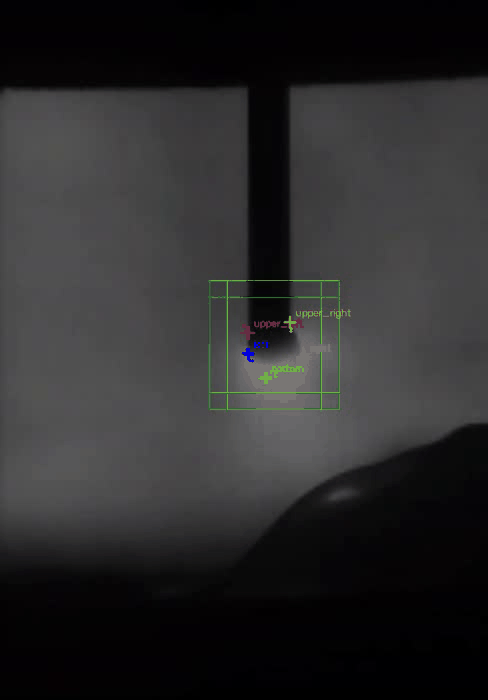
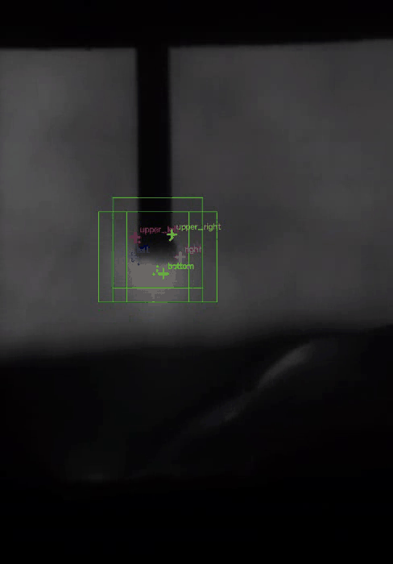
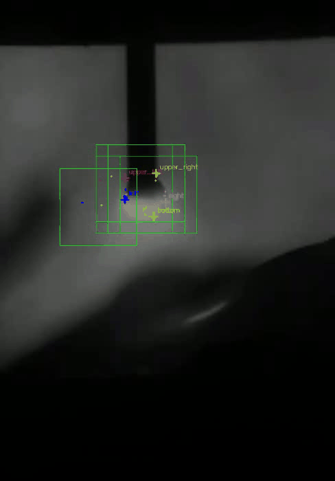
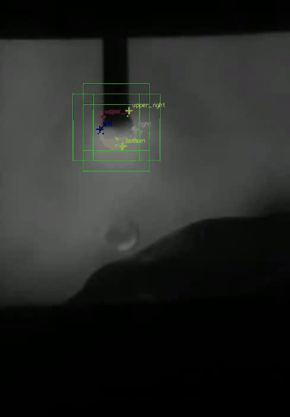
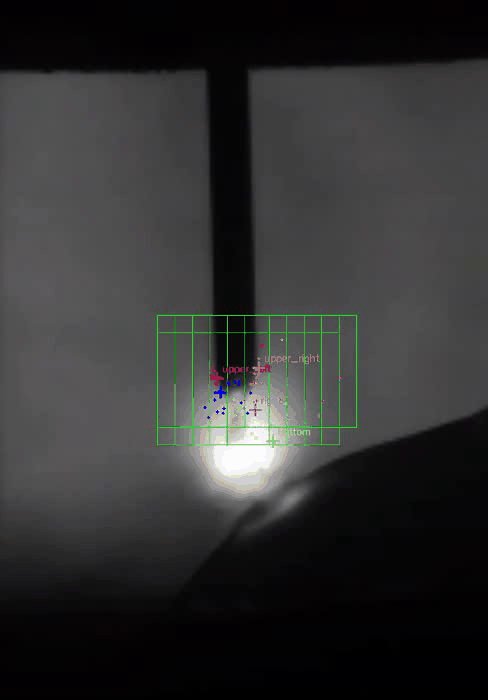
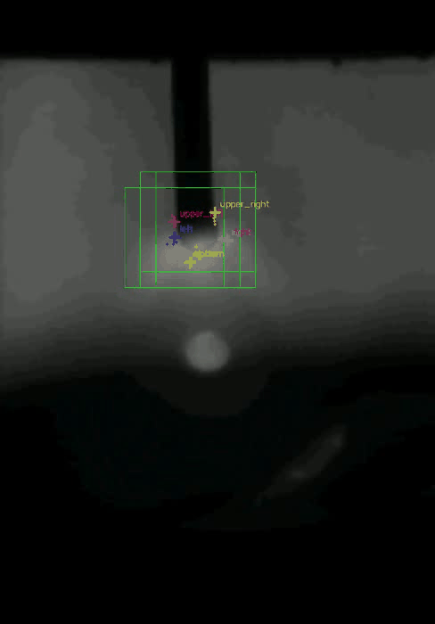

# Deep Learning for Welding Droplet Boundary Detection

This module implements a CNN-based approach to detecting welding droplet boundaries in gas metal arc welding (GMAW) videos.

The method combines image-window classification and coordinate regression. A classification CNN identifies image regions associated with different droplet states, while five independent regression CNNs estimate the coordinates of the droplet boundaries.

The original TensorFlow implementation has been reconstructed using Python 3.11, PyTorch, and OpenCV.

## 1. Overview

The deep-learning pipeline consists of the following stages:

1. **Video preprocessing** — extract individual frames from the original welding videos and generate a sampled-frame dataset.
2. **Manual annotation** — annotate image windows for classification and boundary coordinates for regression.
3. **Dataset construction** — generate grayscale 32 × 32 image crops and construct classification and regression datasets.
4. **Model training** — train one classification CNN and five independent regression CNNs.
5. **Droplet detection** — combine classification and regression predictions to estimate five droplet-boundary points.
6. **Result visualization** — export coordinate CSV files, annotated detection GIFs, and boundary trajectory plots.

The implementation separates preprocessing, annotation, model definitions, training, and detection into independent modules.

## 2. Dataset

### 2.1 Source videos

The deep-learning experiments cover seven welding videos.

| Video ID | Original filename  | Total frames | Droplet transfer cycles |
|----------|--------------------|-------------:|------------------------:|
| 20       | `20_.avi`          |        3,000 |                      20 |
| 21       | `21_.avi`          |        3,000 |                      20 |
| 22       | `22_.avi`          |        3,001 |                       1 |
| 24c      | `24__clip.wmv`     |        1,036 |                      14 |
| 26c      | `26__clip.wmv`     |          737 |                       3 |
| 29       | `29_.avi`          |        3,000 |                      60 |
| 33       | `Y4 Camera33_.avi` |          300 |                       9 |

The droplet transfer cycle counts were determined through manual video inspection.

The original video frames are resized to 40% of their original dimensions during preprocessing. The resulting frames are used for manual annotation, dataset construction, and subsequent detection.

The video IDs are used consistently throughout the preprocessing, annotation, detection, and result directories. For example, `24__clip.wmv` corresponds to video ID `24c`.

The original video recordings used in this project are distributed separately through GitHub Releases to keep the source repository lightweight.

Download the raw video dataset from the [GitHub Releases](../../releases) page and extract the video files into the `data/videos/` directory.

GIF previews of the recordings are available in [`data/video-samples/`](../data/video-samples/).

**Note:** The GIF previews are provided for visual reference only. The original video recordings are required to reproduce the complete preprocessing and dataset construction workflow.

### 2.2 Frame sampling

The sampling procedure selects frames from different videos and droplet-transfer cycles.

Sampling is performed using video-specific strategies:

- Randomly select a source video.
- Randomly select a droplet-transfer cycle.
- Select a frame within that cycle according to the configured sampling strategy.
- Record the source video identifier and original frame index.

Sampling records are saved in `sampling_records.csv`, allowing each sampled image to be traced back to its source video and frame.

The current sampling implementation uses the following source videos:

`20`, `21`, `22`, `24c`, `26c`, `29`, and `33`.

### 2.3 Image windows and annotations

The CNN models operate on grayscale image crops of size **32 × 32 pixels**.

Two annotation tasks are performed.

**Classification annotation**

Four windows are annotated for each sampled frame:

| Class   | Label | Description                                            |
|---------|------:|--------------------------------------------------------|
| `off`   |     0 | Background region without the target droplet structure |
| `full`  |     1 | Window containing the complete target droplet region   |
| `upper` |     2 | Upper region of the droplet                            |
| `lower` |     3 | Lower region of the droplet                            |

The three positive windows (`full`, `upper`, and `lower`) are positioned around the annotated droplet region. A negative window (`off`) is sampled from a background region subject to the overlap constraints implemented in the annotation tool.

Each annotated frame therefore contributes four classification samples.

**Regression annotation**

Five boundary points are manually annotated:

- `upper_left`
- `upper_right`
- `bottom`
- `left`
- `right`

Three image windows are also annotated for each frame:

- `full`
- `upper`
- `lower`

The regression dataset builder checks whether each boundary point lies inside each annotated window. A crop contributes a regression sample for a particular target only when that target point falls within the crop.

The regression labels represent local coordinates within the 32 × 32 crop, using the `[x, y]` coordinate order.

## 3. Dataset Construction

The dataset builder converts the annotation CSV files into compressed NumPy NPZ datasets.

All image crops are converted to grayscale while preserving their original pixel values. The resulting image arrays are stored as 32 × 32 single-channel images.

### 3.1 Classification dataset

Each annotated frame contributes four samples, one for each classification category.

The classification dataset is divided by source-frame index:

| Split     | Source frames | Image samples |
|-----------|--------------:|--------------:|
| Training  |         3,000 |        12,000 |
| Testing   |         1,000 |         4,000 |
| **Total** |     **4,000** |    **16,000** |

All four crops originating from the same source frame are assigned to the same split. This prevents crops from one frame from appearing in both the training and testing sets.

The frame-level split uses a random seed of 42.

Output file:

`classification_dataset.npz`

### 3.2 Regression datasets

Five independent regression datasets are constructed, one for each boundary point.

Each annotated frame provides up to three candidate crops (`full`, `upper`, and `lower`). A crop is included in a target-specific dataset only if the corresponding boundary point lies within that crop.

The configured training and testing sample counts are:

| Target        | Training samples | Testing samples |  Total |
|---------------|-----------------:|----------------:|-------:|
| `upper_left`  |            9,200 |             400 |  9,600 |
| `upper_right` |            9,000 |             100 |  9,100 |
| `bottom`      |            7,680 |             240 |  7,920 |
| `left`        |           10,560 |             400 | 10,960 |
| `right`       |           10,880 |              80 | 10,960 |

The current implementation uses the `sample` split mode. Samples are assigned sequentially: the configured initial samples are used for training, the following samples for testing, and any remaining samples are retained as an additional validation set.

The validation samples are not part of the original training/testing counts recorded in the thesis.

| Target        | Additional validation samples |
|---------------|------------------------------:|
| `upper_left`  |                            55 |
| `upper_right` |                            80 |
| `bottom`      |                            71 |
| `left`        |                            79 |
| `right`       |                            77 |

**Dataset-splitting limitation:** Unlike the classification dataset, the current regression `sample` split does not guarantee that all samples originating from the same source frame remain in one partition. Consequently, samples from the same source frame may appear across training, testing, and validation partitions. This should be considered when interpreting the regression evaluation results.

The dataset builder also supports a `frame` split mode, which separates samples by source-frame index to prevent this type of leakage. However, this mode does not necessarily reproduce the configured historical sample counts.

Output file:

`regression_datasets.npz`

Both datasets are generated using compressed NPZ storage.

## 4. CNN Architectures

Both models use grayscale 32 × 32 image inputs and share a similar convolutional and fully connected structure. Their feature-processing operations and output layers differ according to the task.

### 4.1 Classification CNN

The classification network predicts one of four image-window categories.

Architecture:

| Layer     | Configuration                      | Output       |
|-----------|------------------------------------|--------------|
| Input     | Grayscale image                    | 1 × 32 × 32  |
| Conv1     | 64 filters, 5 × 5, padding 2, ReLU | 64 × 32 × 32 |
| Max Pool1 | 2 × 2                              | 64 × 16 × 16 |
| LRN1      | Size 9                             | 64 × 16 × 16 |
| Conv2     | 64 filters, 5 × 5, padding 2, ReLU | 64 × 16 × 16 |
| LRN2      | Size 9                             | 64 × 16 × 16 |
| Max Pool2 | 2 × 2                              | 64 × 8 × 8   |
| Flatten   | 4,096 features                     | 4,096        |
| FC1       | 384 neurons, ReLU                  | 384          |
| FC2       | 192 neurons, ReLU                  | 192          |
| FC3       | 4 output logits                    | 4            |

Local Response Normalization (LRN) is applied after the first pooling layer and after the second convolutional layer.

The output layer produces four logits corresponding to `off`, `full`, `upper`, and `lower`. Softmax is applied during inference to obtain class probabilities.

The classification network uses cross-entropy loss with an L2 regularization term applied to the first two fully connected weight matrices during training.

### 4.2 Regression CNN

Five independent regression networks are trained to estimate the coordinates of the five boundary points.

Each network has the following architecture:

| Layer     | Configuration                      | Output       |
|-----------|------------------------------------|--------------|
| Input     | Grayscale image                    | 1 × 32 × 32  |
| Conv1     | 64 filters, 5 × 5, padding 2, ReLU | 64 × 32 × 32 |
| Max Pool1 | 2 × 2                              | 64 × 16 × 16 |
| Conv2     | 64 filters, 5 × 5, padding 2, ReLU | 64 × 16 × 16 |
| Max Pool2 | 2 × 2                              | 64 × 8 × 8   |
| Flatten   | 4,096 features                     | 4,096        |
| FC1       | 384 neurons, ReLU                  | 384          |
| FC2       | 192 neurons, ReLU                  | 192          |
| FC3       | 2 output values                    | 2            |

Unlike the classifier, the regression network does not use Local Response Normalization.

The output layer predicts two local coordinates:

`[x, y]`

The regression models use mean squared error (MSE) as their training loss.

The five independent models are:

| Target ID | Model                  | Predicted boundary |
|----------:|------------------------|--------------------|
|         0 | `target_0_upper_left`  | Upper-left         |
|         1 | `target_1_upper_right` | Upper-right        |
|         2 | `target_2_bottom`      | Bottom             |
|         3 | `target_3_left`        | Left               |
|         4 | `target_4_right`       | Right              |

## 5. Model Training

The original TensorFlow training procedures were reconstructed using PyTorch.

### 5.1 Training configuration

| Parameter                     |                    Classification |         Regression |
|-------------------------------|----------------------------------:|-------------------:|
| Optimizer                     |                              Adam |               Adam |
| Learning rate                 |                             0.001 |              0.001 |
| Batch size                    |                               100 |                 80 |
| Epochs in reported experiment |                                20 |                 20 |
| Loss function                 | Cross-entropy + L2 regularization | Mean squared error |
| Random seed                   |                                42 |                 42 |
| Training device               |                              CUDA |               CUDA |

The classification training loss includes the L2 regularization term. The reported test loss is calculated using cross-entropy alone.

For regression, the additional validation partition is used to monitor training progress when available. Final metrics are calculated separately on the held-out test partition.

### 5.2 Training commands

Run the commands from the project root directory after configuring the paths in `deeplearning/settings.py` and preparing the NPZ datasets.

Classification:

```bash
python -m deeplearning.training.train_classification ^
  --npz "D:/Projects/welding-droplet-vision-data/dataset/classification_dataset.npz" ^
  --epochs 20
```

Regression:

```bash
python -m deeplearning.training.train_regression ^
  --npz "D:/Projects/welding-droplet-vision-data/dataset/regression_datasets.npz" ^
  --epochs 20 ^
  --target 0
```

Change `--target` to `1`, `2`, `3`, or `4` to train the other regression models.

### 5.3 Training results

The following metrics were obtained from the recorded 20-epoch CUDA training runs.

**Classification performance**

| Metric              |     Result |
|---------------------|-----------:|
| Training samples    |     12,000 |
| Testing samples     |      4,000 |
| Final training loss |   0.094193 |
| Final test loss     |   0.049914 |
| Test accuracy       | **98.50%** |

**Regression performance**

| Boundary target | Test samples | Test MSE (per coordinate) | Test MAE (pixels) | Within-2px sample accuracy |
|-----------------|-------------:|--------------------------:|------------------:|---------------------------:|
| Upper-left      |          400 |                  2.230845 |            1.0599 |                     94.00% |
| Upper-right     |          100 |                  1.487209 |            0.8605 |                     98.00% |
| Bottom          |          240 |                  2.183379 |            1.0113 |                     93.75% |
| Left            |          400 |                  1.826351 |            0.8533 |                     95.25% |
| Right           |           80 |                  1.141865 |            0.7962 |                     96.25% |

**Metric definitions:**

- **MSE:** Mean squared error over the two predicted coordinates, reported per coordinate.
- **MAE:** Mean absolute error over the two predicted coordinates, reported in pixels.
- **Within-2px sample accuracy:** Percentage of samples for which both predicted coordinates satisfy the implementation's within-2-pixel criterion.

The within-2px metric reproduces the integer-coordinate comparison used by the original implementation. It is a sample-level metric, not a percentage of individually correct coordinates.

The regression test-set sizes differ substantially between targets. The sample counts should therefore be considered alongside the reported metrics.

### 5.4 Checkpoints and training logs

The trained model checkpoints and training records are preserved under:

[`data/results/deep-learning/checkpoints/`](../data/results/deep-learning/checkpoints/)

The checkpoint collection contains:

- `classification_cnn.pt` — trained classification network.
- `regression_cnn.pt` — one checkpoint for each of the five regression targets.
- `training.log` — recorded training output and evaluation metrics.

The training scripts also save per-epoch training histories as CSV files when training is performed.

The checkpoints can be loaded by the detection module for inference.

## 6. Droplet Boundary Detection

The detection pipeline combines the classification network with the five regression networks.

### 6.1 Sliding-window generation

For each input frame:

1. Convert the image to grayscale.
2. Generate 32 × 32 sliding windows.
3. Move the window horizontally and vertically using a configurable stride.
4. Normalize grayscale pixel values to the range [0, 1].
5. Classify the windows row by row.

The default detection configuration uses:

| Parameter                                         | Default value |
|---------------------------------------------------|--------------:|
| Window size                                       |       32 × 32 |
| Image margin                                      |     15 pixels |
| Sliding-window stride                             |      5 pixels |
| Additional scan rows after first `full` detection |             3 |
| Classification batch size                         |           100 |
| Regression batch size                             |            80 |

The row-wise scanning process stops after the first row containing a `full` classification prediction and the configured number of additional rows have been scanned.

Only windows classified as `full` are retained as regression candidates.

### 6.2 Boundary coordinate regression

Each retained window is passed independently to all five regression networks.

The networks predict local coordinates within their respective 32 × 32 windows.

The local predictions are converted into image coordinates by adding the corresponding window origins:

\[
P_{\mathrm{global}} = P_{\mathrm{local}} + P_{\mathrm{window}}
\]

Predictions outside the original image boundaries are discarded.

### 6.3 Spatial clustering and representative-point selection

Multiple windows can produce predictions for the same boundary point. Spatial clustering is therefore applied to consolidate the candidate predictions.

The implementation uses target-specific selection policies:

| Target      | Clustering distance threshold (squared) | Representative-point selection                                                  |
|-------------|----------------------------------------:|---------------------------------------------------------------------------------|
| Upper-left  |                                       2 | Select the point with maximum y-coordinate in the largest cluster               |
| Upper-right |                                       2 | Select the point with minimum y-coordinate in the largest cluster               |
| Bottom      |                             Not applied | Select the point with maximum y-coordinate among all predictions                |
| Left        |                                       2 | Select the minimum x-coordinate and maximum y-coordinate in the largest cluster |
| Right       |                                       8 | Select the maximum x-coordinate and maximum y-coordinate in the largest cluster |

For the four targets using clustering, the largest connected component is selected using squared Euclidean distance.

The final representative coordinates are rounded to integer image coordinates.

### 6.4 Detection outputs

For each processed video, the detection module generates:

- An annotated image for every processed frame.
- A CSV file containing the five estimated boundary points for each frame.

The CSV schema is:

```text
frame_index,
upper_left_x, upper_left_y,
upper_right_x, upper_right_y,
bottom_x, bottom_y,
left_x, left_y,
right_x, right_y
```

If a boundary cannot be detected in a frame, its corresponding coordinate fields are left empty.

The annotated frames can subsequently be assembled into GIF or video visualizations.

## 7. Experimental Results

The following examples show the deep-learning detection results for all seven source videos.

Each GIF visualizes the classification windows and regression predictions. The corresponding boundary trajectory plots show the estimated coordinate changes across the processed frames.

### 7.1 Video 20



Boundary trajectories:

- [Upper-left](../data/results/deep-learning/20/plots/upper_left.png)
- [Upper-right](../data/results/deep-learning/20/plots/upper_right.png)
- [Bottom](../data/results/deep-learning/20/plots/bottom.png)
- [Left](../data/results/deep-learning/20/plots/left.png)
- [Right](../data/results/deep-learning/20/plots/right.png)

[Detection coordinates (CSV)](../data/results/deep-learning/20/detection.csv)

### 7.2 Video 21



Boundary trajectories:

- [Upper-left](../data/results/deep-learning/21/plots/upper_left.png)
- [Upper-right](../data/results/deep-learning/21/plots/upper_right.png)
- [Bottom](../data/results/deep-learning/21/plots/bottom.png)
- [Left](../data/results/deep-learning/21/plots/left.png)
- [Right](../data/results/deep-learning/21/plots/right.png)

[Detection coordinates (CSV)](../data/results/deep-learning/21/detection.csv)

### 7.3 Video 22



Boundary trajectories:

- [Upper-left](../data/results/deep-learning/22/plots/upper_left.png)
- [Upper-right](../data/results/deep-learning/22/plots/upper_right.png)
- [Bottom](../data/results/deep-learning/22/plots/bottom.png)
- [Left](../data/results/deep-learning/22/plots/left.png)
- [Right](../data/results/deep-learning/22/plots/right.png)

[Detection coordinates (CSV)](../data/results/deep-learning/22/detection.csv)

### 7.4 Video 24c



Boundary trajectories:

- [Upper-left](../data/results/deep-learning/24c/plots/upper_left.png)
- [Upper-right](../data/results/deep-learning/24c/plots/upper_right.png)
- [Bottom](../data/results/deep-learning/24c/plots/bottom.png)
- [Left](../data/results/deep-learning/24c/plots/left.png)
- [Right](../data/results/deep-learning/24c/plots/right.png)

[Detection coordinates (CSV)](../data/results/deep-learning/24c/detection.csv)

### 7.5 Video 26c



Boundary trajectories:

- [Upper-left](../data/results/deep-learning/26c/plots/upper_left.png)
- [Upper-right](../data/results/deep-learning/26c/plots/upper_right.png)
- [Bottom](../data/results/deep-learning/26c/plots/bottom.png)
- [Left](../data/results/deep-learning/26c/plots/left.png)
- [Right](../data/results/deep-learning/26c/plots/right.png)

[Detection coordinates (CSV)](../data/results/deep-learning/26c/detection.csv)

### 7.6 Video 29



Boundary trajectories:

- [Upper-left](../data/results/deep-learning/29/plots/upper_left.png)
- [Upper-right](../data/results/deep-learning/29/plots/upper_right.png)
- [Bottom](../data/results/deep-learning/29/plots/bottom.png)
- [Left](../data/results/deep-learning/29/plots/left.png)
- [Right](../data/results/deep-learning/29/plots/right.png)

[Detection coordinates (CSV)](../data/results/deep-learning/29/detection.csv)

### 7.7 Video 33



Boundary trajectories:

- [Upper-left](../data/results/deep-learning/33/plots/upper_left.png)
- [Upper-right](../data/results/deep-learning/33/plots/upper_right.png)
- [Bottom](../data/results/deep-learning/33/plots/bottom.png)
- [Left](../data/results/deep-learning/33/plots/left.png)
- [Right](../data/results/deep-learning/33/plots/right.png)

[Detection coordinates (CSV)](../data/results/deep-learning/33/detection.csv)

All detection outputs are organized by video identifier under [`data/results/deep-learning/`](../data/results/deep-learning/).

See [`data/README.md`](../data/README.md) for the complete data organization, metadata, video samples, and result files.

## 8. Project Structure

```text
deeplearning/
├── README.md
├── settings.py
│
├── preprocessing/
│   ├── extract_frames.py
│   └── sample_frames.py
│
├── annotation/
│   ├── annotate_classification.py
│   ├── annotate_regression.py
│   ├── build_dataset.py
│   └── viewer.py
│
├── models/
│   ├── classifier.py
│   └── regressor.py
│
├── training/
│   ├── train_classification.py
│   └── train_regression.py
│
├── detection/
│   ├── detect_droplet.py
│   ├── create_video.py
│   └── viewer.py
│
└── utils/
    └── fileutils.py
```

## 9. Environment and Dependencies

The reconstructed implementation uses:

- Python 3.11
- PyTorch
- NumPy
- OpenCV
- tqdm

Training uses CUDA when an available CUDA-compatible PyTorch environment is detected. Otherwise, the training scripts fall back to CPU execution.

The project paths and video metadata are configured in `settings.py`. Before running the pipeline in another environment, update `BASE_PATH` and `DATA_PATH` to match the local directory structure.

The NPZ datasets and original video files are maintained separately from the source-code directory.

## 10. Reproducibility and Limitations

The deep-learning implementation preserves the original classification and regression workflow while modernizing the software stack.

Several considerations are important when reproducing or interpreting the experiments:

- **Reconstructed implementation:** The current PyTorch implementation is a reconstruction of the original TensorFlow-based models and data-processing workflow.
- **Dataset-specific annotations:** The models are trained using manually annotated samples from seven welding videos.
- **Regression split:** The reported regression results use sequential sample-based partitioning. Source-frame overlap between training, validation, and test partitions is possible.
- **Unequal regression test sizes:** The five regression targets have different numbers of test samples. Their metrics should not be interpreted as directly equivalent evaluations.
- **Dataset generalization:** The reported results describe performance on the constructed dataset and do not establish generalization to arbitrary welding conditions, cameras, illumination settings, or droplet-transfer regimes.
- **Historical versus reconstructed results:** The reported 20-epoch training metrics belong to the reconstructed PyTorch experiments. They should not be confused with the original thesis results.

The original video data, annotations, generated datasets, trained checkpoints, and visualized detection results are maintained as separate research artifacts to support inspection and further experimentation.

## 11. Research Context

This deep-learning module provides a data-driven approach to welding droplet boundary estimation.

The classification network identifies image regions containing different parts of the droplet structure, while the five regression networks estimate the corresponding boundary coordinates.

Compared with the traditional-vision module, which relies on edge extraction, contour tracing, and geometric rules, this approach learns image features directly from manually annotated grayscale crops.

The two approaches provide complementary perspectives for analysing the dynamic behaviour of welding droplet transfer.
