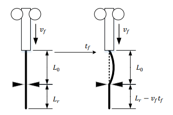
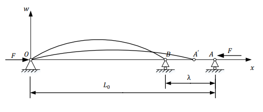
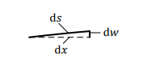
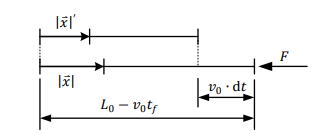
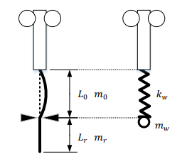
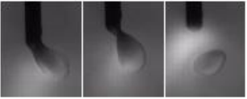
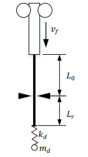
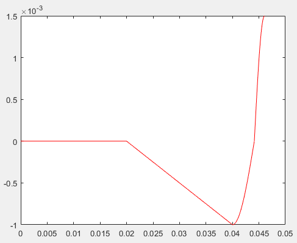
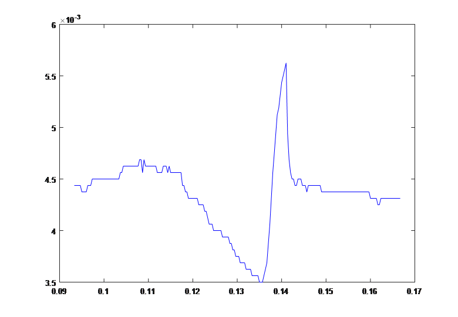
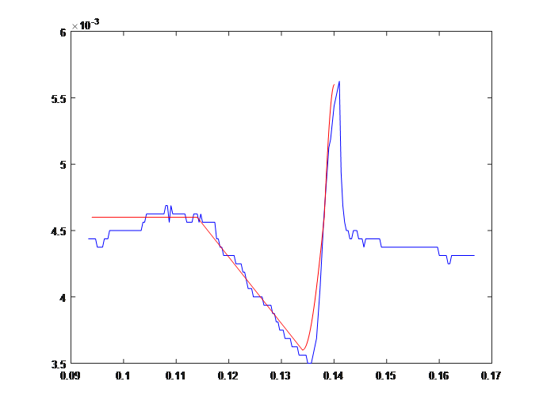

# Theoretical Modeling of Droplet Transfer Dynamics

> This document presents the theoretical model developed for piezoelectric-actuator-assisted gas metal arc welding (GMAW). It follows the structure and mathematical development of the original Chapter 4, with equations transcribed into Markdown-compatible LaTeX.
>
> The original thesis figures are intentionally kept as image placeholders. Export the corresponding figures from the source thesis and save them using the paths specified in the figure manifest at the end of this document.
>
> **Source and interpretation note:** The equations and physical assumptions below are transcribed from the original thesis. They are not a new derivation or an independent experimental validation. In particular, the printed form of Equation (4-13) appears inconsistent with the differential equation in Equation (4-12); this discrepancy is explicitly retained and discussed rather than silently corrected.

## 1. Physical Principle and Experimental Parameters

### 1.1 Piezoelectric-actuator-assisted GMAW

In conventional GMAW, the wire is continuously fed towards the arc. The wire tip is heated and melts, forming a droplet that eventually transfers to the weld pool. The timing of this transfer is difficult to control precisely because it depends on the welding conditions and the forces acting on the droplet.

Piezoelectric-actuator-assisted GMAW introduces an additional mechanical control mechanism. A piezoelectric actuator periodically clamps and releases the wire:

1. The wire is continuously fed while the melting rate is balanced by the feeding rate.
2. The actuator clamps the wire at a position near its tip. The wire tip stops advancing, while the wire behind the clamping point continues to be fed.
3. The wire bends and stores elastic potential energy.
4. The actuator releases the wire. The bent wire rebounds towards its original straight configuration.
5. The rapid motion of the wire tip accelerates the attached droplet. The droplet subsequently separates from the wire and falls towards the weld pool.

The complete transfer cycle is therefore modeled as four consecutive stages:

- Droplet dwelling
- Wire energy storage
- Wire rebound
- Droplet detachment

The objective of the model is to describe the droplet displacement over one complete cycle.

### 1.2 Physical model and notation

The original physical model is illustrated in Figure 4-1.



The principal parameters used in the model are listed below.

| Symbol    |                    Value | Unit  | Description                                     |
|-----------|-------------------------:|-------|-------------------------------------------------|
| $$v_f$$   |                     0.05 | m/s   | Wire feeding velocity                           |
| $$t_f$$   |                     0.02 | s     | Wire clamping duration                          |
| $$t_r$$   |                     0.03 | s     | Wire release duration                           |
| $$L_0$$   |                     0.06 | m     | Length of the equivalent spring segment         |
| $$L_r$$   |                     0.08 | m     | Length of the remaining wire segment            |
| $$E$$     |        $$206\times10^9$$ | Pa    | Young's modulus of the wire                     |
| $$d_w$$   |                   0.0008 | m     | Wire diameter                                   |
| $$A$$     |  $$5.0265\times10^{-7}$$ | m²    | Wire cross-sectional area                       |
| $$I$$     | $$2.0106\times10^{-14}$$ | m⁴    | Second moment of area of the wire cross-section |
| $$rho_w$$ |        $$7.9\times10^3$$ | kg/m³ | Wire density                                    |
| $$rho_d$$ |        $$6.8\times10^3$$ | kg/m³ | Droplet density                                 |

Here, $$v_f$$ denotes the wire feeding velocity, while $$v_m$$ denotes the melting velocity of the wire tip. The coordinate $$x(t)$$ represents the droplet displacement under the coordinate convention used in the original model.

## 2. Four Stages of Droplet Transfer

### 2.1 Stage I — Droplet dwelling

During the dwelling stage, the wire is continuously fed towards the arc and melts at its tip. To maintain the droplet at an approximately fixed position, the wire feeding velocity must equal the melting velocity:

$$
v_m=v_f
\qquad (4\text{-}1)
$$

Using the experimental parameters:

$$
v_m=v_f=0.05\ \mathrm{m/s}
$$

The droplet therefore remains at an approximately constant displacement, denoted by $$x_0$$.

Let $$t_1$$ be the duration of this stage. In the experiment:

$$
t_1=0.02\ \mathrm{s}
$$

The displacement function is:

$$
x(t)=x_0
\qquad (4\text{-}2)
$$

where:

$$
t_0<t\leq t_0+t_1
$$

Here, $$t_0$$ is an assumed initial time used to align the theoretical model with an experimental displacement curve.

### 2.2 Stage II — Wire energy storage

After the dwelling stage, the piezoelectric actuator clamps the wire. The wire tip is stopped, but the wire behind the clamping point continues to move forward at the feeding velocity.

The wire consequently bends and accumulates elastic potential energy. Meanwhile, because the wire tip is no longer advancing, the melting process causes the droplet to move upwards at the melting velocity $$v_m$$.

Let $$t_2$$ denote the duration of this stage. It corresponds to the clamping duration:

$$
t_2=t_f=0.02\ \mathrm{s}
$$

The droplet displacement is therefore:

$$
x(t)=x_0-v_m(t-t_0-t_1)
\qquad (4\text{-}3)
$$

for:

$$
t_0+t_1<t\leq t_0+t_1+t_2
$$

Since $$v_m=0.05\ \mathrm{m/s}$$, the droplet moves upwards at a constant velocity during this stage under the model's coordinate convention.

#### 2.2.1 Wire deflection and endpoint displacement

Besides the droplet displacement, the wire's bending deformation is another important characteristic of the energy-storage stage.

The bent wire is approximated as an elastically deformed compression member. As illustrated in Figure 4-2, an external force $$F$$ is applied at the moving endpoint $$A$$, causing it to move in the negative $$x$$-direction at a constant velocity $$v_f$$.



After a clamping duration $$t_f$$, the endpoint has moved from $$A$$ to $$B$$. Denote the total endpoint displacement by $$\lambda$$:

$$
\lambda=v_f t_f
\qquad (4\text{-}4)
$$

For the experimental parameters:

$$
\lambda=0.05\times0.02=0.001\ \mathrm{m}
$$

Since $$\lambda$$ is small compared with the wire segment length $$L_0$$, the original analysis assumes that the applied force $$F$$ can be treated as approximately constant.

#### 2.2.2 Deflection curve of the wire

Considering axial deformation of the compression member, the original thesis adopts the following deflection function:

$$
w(x)=A\sin(kx)
\qquad (4\text{-}5)
$$

where:

$$
k=\sqrt{\frac{F}{EI}}
$$

Here:

- $$w(x)$$ is the lateral deflection of the wire;
- $$A$$ is the deflection amplitude;
- $$F$$ is the applied compressive force;
- $$E$$ is Young's modulus;
- $$I$$ is the second moment of area.

Differentiating Equation (4-5) gives:

$$
\frac{dw}{dx}=Ak\cos(kx)
\qquad (4\text{-}6)
$$

To determine the amplitude $$A$$, consider a small element of the deflected wire, as illustrated in Figure 4-3.



Let $$ds$$ denote the length of an infinitesimal element along the deflection curve, and $$dx$$ its projection onto the $$x$$-axis. The total endpoint displacement is related to the difference between the curved length and its horizontal projection:

$$
\lambda=\int_0^{L_0-\lambda}(ds-dx)
\qquad (4\text{-}7)
$$

From the geometry of the infinitesimal element:

$$
ds=\sqrt{dx^2+dw^2}
$$

Therefore:

$$
ds=
\sqrt{1+\left(\frac{dw}{dx}\right)^2}\,dx
$$

Using the small-slope approximation:

$$
\sqrt{1+\epsilon}\approx1+\frac{\epsilon}{2}
$$

gives:

$$
ds\approx
\left[
1+\frac{1}{2}
\left(\frac{dw}{dx}\right)^2
\right]dx
\qquad (4\text{-}8)
$$

Substituting Equation (4-6) into Equation (4-8), and then substituting the resulting expression into Equation (4-7), yields the following relation:

$$
\lambda=
\frac{A^2}{8}
\left[
2k^2(L_0-v_ft_f)
+k\left(
\sin(2kL_0)-\sin(2kv_ft_f)
\right)
\right]
\qquad (4\text{-}9)
$$

Since $$\lambda=v_ft_f$$, solving for the amplitude gives:

$$
A=
2\sqrt{2}
\sqrt{
\frac{v_ft_f}{
2k^2(L_0-v_ft_f)
+k\left[
\sin(2kL_0)-\sin(2kv_ft_f)
\right]
}
}
\qquad (4\text{-}10)
$$

This provides the deflection amplitude in terms of the wire feeding velocity, clamping duration, wire length and the parameter $$k$$.

#### 2.2.3 Time-dependent deflection profile

The original analysis further considers how the deflection profile changes as the wire continues to move.

As the endpoint advances, the effective length of the bent wire decreases. The coordinate system associated with the deflection curve therefore changes over time.

Figure 4-4 illustrates the movement of the endpoint over an infinitesimal time interval.



Let $$|x|$$ and $$|x|'$$ denote the magnitudes of the coordinate vectors before and after the endpoint moves a distance $$v_fdt$$, respectively.

The original analysis assumes that the ratio between the position of a point on the deflection curve and the total current wire length remains unchanged:

$$
\frac{|x|}{L_0-v_ft_f} = \frac{|x|'}{L_0-v_ft_f-v_fdt}
\qquad (4\text{-}11)
$$

Defining:

$$
d|x|=|x|-|x|'
$$

the thesis obtains:

$$
\frac{d|x|}{dt} = \frac{|x|v_f}{L_0-v_ft_f}
\qquad (4\text{-}12)
$$

The printed form of Equation (4-13) is:

$$
|x|=
\frac{Cv_f}{L_0-v_ft_f}
\qquad (4\text{-}13)
$$

where $$C$$ is a constant.

Substituting this expression into Equation (4-5), the original thesis writes the deflection function in the form:

$$
w=A\sin(|x|kx)
$$

Using the boundary condition that $$w=0$$ when $$t=0$$ and $$x=L_0$$, the thesis obtains:

$$
C=\frac{\pi}{kv_f}
\qquad (4\text{-}14)
$$

Finally, substituting Equations (4-10) and (4-14) into the deflection function gives the time-dependent wire deflection expression:

$$
\boxed{
w(x)=
2\sqrt{2}
\sqrt{
\frac{v_ft_f}{
2k^2(L_0-v_ft_f)
+k\left[
\sin(2kL_0)-\sin(2kv_ft_f)
\right]
}
}
\sin\left(
\frac{\pi x}{L_0-v_ft_f}
\right)
}
\qquad (4\text{-}15)
$$

where:

$$
k=\sqrt{\frac{F}{EI}}
$$

This expression describes the wire deflection profile under the assumptions used in the original analysis.

**Mathematical consistency note:** Equation (4-12), as printed, is a differential equation whose direct integration with constant $$L_0-v_ft_f$$ would produce an exponential dependence on time. The printed Equation (4-13) does not show that dependence. In addition, the intermediate expression $$w=A\sin(|x|kx)$$ and the final Equation (4-15) do not make the same coordinate dependence explicit. The original equations are retained here as printed; this intermediate derivation should be checked against the original typeset source or the cited compression-member reference before being used as an independently verified derivation.

### 2.3 Stage III — Wire rebound

When the piezoelectric actuator releases the wire, the elastic potential energy accumulated during the previous stage is released.

The bent wire tends to return to its original straight configuration. The original model approximates this motion as the rebound of an equivalent spring.

The equivalent mechanical model is shown in Figure 4-5.



The wire is divided into two segments:

- $$L_0$$: the segment represented by the equivalent spring;
- $$L_r$$: the remaining wire segment, represented by an additional moving mass.

The mass of a wire segment is:

$$
m=\rho AL
\qquad (4\text{-}16)
$$

where $$\rho$$ is the wire density, $$A$$ is the cross-sectional area and $$L$$ is the segment length.

Using the experimental parameters, the original thesis obtains:

$$
m_0=2.3826\times10^{-4}\ \mathrm{kg}
$$

$$
m_r=3.1768\times10^{-4}\ \mathrm{kg}
$$

The equivalent mass of a uniformly distributed spring is one-third of its total mass. Therefore, the equivalent oscillating mass is:

$$
m_w=\frac{1}{3}m_0+m_r
\qquad (4\text{-}17)
$$

The equivalent spring stiffness is:

$$
k_w=\frac{3EI}{L_0^3}
\qquad (4\text{-}18)
$$

During the energy-storage stage, the wire endpoint moves by $$\lambda$$. When the wire rebounds to its original straight configuration, the endpoint approximately returns through the same displacement. Thus, the rebound amplitude is taken as $$\lambda$$.

The wire is modeled as a simple harmonic oscillator starting from zero velocity and accelerating towards its maximum velocity.

The resulting droplet displacement is:

$$
x(t)=
x_0-
\lambda
\sin\left[
\sqrt{\frac{k_w}{m_w}}
(t-t_0-t_1-t_2)
+\frac{\pi}{2}
\right]
\qquad (4\text{-}19)
$$

for:

$$
t_0+t_1+t_2
<
t
\leq
t_0+t_1+t_2+t_w
$$

The duration of this stage is one quarter of the equivalent spring's oscillation period:

$$
t_w=\frac{T_w}{4}=\frac{\pi}{2} \sqrt{\frac{m_w}{k_w}}
\qquad (4\text{-}20)
$$

This stage represents the rapid downward movement of the wire tip and the attached droplet during wire rebound.

### 2.4 Stage IV — Droplet detachment

When the wire returns to its original straight configuration, the strong axial tensile stress causes the wire tip velocity to decrease rapidly. The original model approximates the wire tip as stationary after this transition.

The droplet, however, retains its downward velocity due to inertia. The liquid bridge connecting the droplet to the wire becomes progressively thinner until the droplet overcomes the surface-tension force and separates from the wire.

The physical detachment process is illustrated in Figure 4-6.



The original model represents this process as another simple harmonic motion, with the droplet treated as a mass attached to an equivalent spring. The motion starts at the maximum-velocity position and continues towards the maximum elastic-potential-energy position.

When the restoring force exceeds the surface-tension threshold, the equivalent oscillator model ceases to describe the physical system, and the droplet detaches.

#### 2.4.1 Equivalent stiffness of the droplet



Based on the referenced theoretical work, the equivalent spring stiffness is given by:

$$
k_d=7.74+127961.29m_d
\qquad (4\text{-}21)
$$

where $$m_d$$ is the droplet mass.

During the detachment stage, the droplet volume is assumed to remain approximately constant. The droplet diameter is taken to be twice the wire diameter:

$$
d_d=2d_w=0.0016\ \mathrm{m}
$$

The droplet is approximated as a sphere. Its mass is therefore:

$$
m_d=\rho_dV_d
$$

with:

$$
V_d=\frac{\pi d_d^3}{6}
$$

Hence:

$$
m_d=\rho_d\frac{\pi d_d^3}{6}
\qquad (4\text{-}22)
$$

#### 2.4.2 Determining the droplet oscillation amplitude

The droplet enters this stage with an initial velocity $$v$$. As it moves downwards, its kinetic energy and gravitational potential energy are converted into elastic potential energy in the equivalent spring.

At the maximum displacement, the original model assumes that the droplet's kinetic energy and gravitational potential energy have both decreased to zero, while the elastic potential energy reaches its maximum.

The energy balance is:

$$
E_k+m_dgh_d=E_p
$$

or:

$$
\frac{1}{2}m_dv^2 + m_dgh_d = \frac{1}{2}k_dh_d^2
\qquad (4\text{-}23)
$$

where:

- $$v$$ is the initial droplet velocity at the beginning of the detachment stage;
- $$h_d$$ is the maximum downward displacement, corresponding to the oscillation amplitude;
- $$g$$ is gravitational acceleration.

The initial velocity $$v$$ is obtained by differentiating the wire-rebound displacement function in Equation (4-19). The original thesis estimates:

$$
v\approx0.38\ \mathrm{m/s}
$$

Substituting this value and the experimental parameters into Equation (4-23), the positive solution is:

$$
h_d=0.0015\ \mathrm{m}
$$

The original analysis then compares the restoring force with the surface-tension threshold.

The restoring force at the maximum displacement is:

$$
F_r=k_dh_d
$$

The surface-tension threshold is represented by:

$$
F_t=1.2C_d
$$

where $$C_d$$ is the circumference of the wire cross-section:

$$
C_d=\pi d_d
$$

The original thesis concludes that:

$$
F_r>F_t
$$

Therefore, the droplet can overcome the surface-tension force and detach from the wire.

#### 2.4.3 Droplet displacement during detachment

The droplet displacement during this stage is modeled as:

$$
\begin{aligned}
x(t)=\;&
x_0-
\lambda
\sin\left(
\sqrt{\frac{k_w}{m_w}}t_w+\frac{\pi}{2}
\right)\\
&+
h_d
\sin\left[
\sqrt{\frac{k_d}{m_d}}
(t-t_0-t_1-t_2-t_w)
\right]
\end{aligned}
\qquad (4\text{-}24)
$$

for:

$$
t_0+t_1+t_2+t_w
<
t
\leq
t_0+t_1+t_2+t_w+t_d
$$

The duration of the detachment stage is one quarter of the equivalent droplet oscillator's period:

$$
t_d=\frac{T_d}{4}
=
\frac{\pi}{2}
\sqrt{\frac{m_d}{k_d}}
\qquad (4\text{-}25)
$$

After this stage, the droplet has separated from the wire and the transfer cycle is complete.

## 3. Integrated Droplet Displacement Model

The four stages can now be combined into a single piecewise displacement function.

The first stage describes a stationary droplet. The second stage describes constant-velocity upward motion caused by wire melting. The third stage describes the downward acceleration associated with wire rebound. The fourth stage describes the droplet's decelerating motion during detachment.

Substituting the experimental parameters into the stage-specific equations gives the following model:

$$
x(t)=
\begin{cases}
x_0,
&
t_0<t\leq t_0+0.02
\\[5pt]
x_0-0.05(t-t_0-0.02),
&
t_0+0.02<t\leq t_0+0.04
\\[5pt]
x_0-0.001
\sin\left[
380.6(t-t_0-0.04)+\frac{\pi}{2}
\right],
&
t_0+0.04<t\leq t_0+0.0441
\\[5pt]
x_0+0.0015
\sin\left[
811.6(t-t_0-0.0441)
\right],
&
t_0+0.0441<t\leq t_0+0.0461
\end{cases}
\qquad (4\text{-}26)
$$

The displacement is measured in metres and time in seconds.

The parameters $$x_0$$ and $$t_0$$ are arbitrary alignment parameters. They determine the position and time at which the theoretical cycle begins.

The theoretical displacement curve with $$x_0=t_0=0$$ is illustrated in Figure 4-7.



The first two stages are directly associated with the wire-feeding system and the piezoelectric actuator. The latter two stages describe the subsequent release of the stored elastic energy and the detachment of the droplet.

The original analysis observes that the latter two stages account for approximately 15% of the directly controlled time. This indicates that the actuator and wire-feeding system govern most of the droplet transfer cycle.

## 4. Comparison Between the Theoretical Model and Experimental Results

The theoretical model is compared with the droplet displacement measured from the experimental image sequence.

The original CNN-based detection algorithm identifies the droplet boundary in each image and produces a displacement trajectory. A representative experimental trajectory is shown in Figure 4-8.



The horizontal axis represents time in seconds. The vertical axis represents the droplet displacement relative to the upper boundary of the video image, expressed in metres.

From the representative experimental curve, the original analysis selects the following alignment parameters:

$$
x_0=4.6\times10^{-3}\ \mathrm{m}
$$

$$
t_0=0.094\ \mathrm{s}
$$

These values are substituted into Equation (4-26) to align the theoretical curve with the experimental trajectory.

The comparison is shown in Figure 4-9.



The original thesis reports that the theoretical trajectory agrees closely with the experimental trajectory, with an overall agreement of approximately 90%.

Some differences remain. For example, the experimental displacement near the left side of the comparison curve is slightly lower than the theoretical prediction. The original analysis suggests that this may be caused by variations in the actual wire feeding velocity or sudden changes in the wire melting velocity, which would disturb the assumed balance between the two velocities.

The comparison therefore provides experimental support for the proposed theoretical model under the tested welding conditions.

**Scope of the reported agreement:** The approximately 90% agreement is the result reported in the original thesis for its representative comparison between the theoretical model and the CNN-derived droplet displacement trajectory. It should not be interpreted as a newly calculated metric for the reconstructed PyTorch implementation, nor as validation of every boundary predicted by the current detection pipeline.

## 5. Summary

The theoretical model describes one complete droplet transfer cycle in piezoelectric-actuator-assisted GMAW through four consecutive stages:

1. **Droplet dwelling:** The wire melting velocity and feeding velocity are balanced, keeping the droplet at an approximately fixed position.
2. **Wire energy storage:** The actuator clamps the wire. Continued feeding causes the wire to bend and accumulate elastic potential energy.
3. **Wire rebound:** Releasing the actuator allows the wire to recover its original shape. The rebound is approximated by an equivalent spring oscillator.
4. **Droplet detachment:** The wire tip rapidly decelerates, while the droplet continues moving due to inertia. The droplet is modeled as an equivalent oscillator until it overcomes the surface-tension threshold and separates from the wire.

The resulting piecewise displacement function provides a theoretical description of the complete transfer cycle. Its comparison with the CNN-derived experimental trajectory was reported to show approximately 90% agreement in the original thesis.

The model, its assumptions, the intermediate wire-deflection analysis and the experimental comparison provide a theoretical reference for further investigation of piezoelectric-actuator-assisted GMAW.

---

## 6. Figure Asset Manifest

Export the corresponding original thesis figures as PNG files and place them under `docs/figures/`.

| Original figure                | Suggested filename                                | Content                                                         |
|--------------------------------|---------------------------------------------------|-----------------------------------------------------------------|
| Figure 4-1                     | `fig-4-1-physical-model.png`                      | Physical model and wire geometry during the transfer cycle      |
| Figure 4-2                     | `fig-4-2-compression-member-model.png`            | Compression-member model used to analyze wire bending           |
| Figure 4-3                     | `fig-4-3-wire-deflection-element.png`             | Infinitesimal element along the deflected wire                  |
| Figure 4-4                     | `fig-4-4-deflection-coordinate-evolution.png`     | Evolution of the deflection coordinate system as the wire moves |
| Figure 4-5                     | `fig-4-5-equivalent-wire-spring.png`              | Equivalent spring and mass model of the wire                    |
| Figure 4-6 (first occurrence)  | `fig-4-6-droplet-detachment.png`                  | Physical schematic of droplet detachment                        |
| Figure 4-6 (second occurrence) | `fig-4-6-droplet-equivalent-model.png`            | Simplified equivalent spring-mass model of the droplet          |
| Figure 4-7                     | `fig-4-7-theoretical-displacement-curve.png`      | Theoretical droplet displacement curve                          |
| Figure 4-8                     | `fig-4-8-experimental-displacement-curve.png`     | Representative experimental displacement trajectory             |
| Figure 4-9                     | `fig-4-9-theoretical-experimental-comparison.png` | Comparison between theoretical and experimental trajectories    |

**Note on original figure numbering:** The original PDF uses the caption “Figure 4-6” twice: once for the droplet-detachment schematic and again for its simplified equivalent model. The filenames above distinguish these two separate assets without silently changing the original figure references.

### Suggested directory structure

```text
welding-droplet-vision/
├── docs/
│   ├── theoretical_model.md
│   └── figures/
│       ├── fig-4-1-physical-model.png
│       ├── fig-4-2-compression-member-model.png
│       ├── fig-4-3-wire-deflection-element.png
│       ├── fig-4-4-deflection-coordinate-evolution.png
│       ├── fig-4-5-equivalent-wire-spring.png
│       ├── fig-4-6-droplet-detachment.png
│       ├── fig-4-6-droplet-equivalent-model.png
│       ├── fig-4-7-theoretical-displacement-curve.png
│       ├── fig-4-8-experimental-displacement-curve.png
│       └── fig-4-9-theoretical-experimental-comparison.png
```

### Reproduction and interpretation notes

- The original figures should be exported without thesis headers, personal names, institutional marks or other identifying information.
- Preserve the original diagrams and curve shapes. Do not redraw or modify the theoretical model while exporting.
- Figure 4-9 is the original theoretical-versus-experimental comparison. It should be presented as a historical result from the original study, not as a new result from the reconstructed implementation.
- The current reconstructed detection outputs use image-pixel coordinates. A direct comparison with the theoretical curve in metres requires a documented pixel-to-distance calibration.
- The original model's parameter values and assumptions are retained for historical reproducibility. They should not be treated as universal material constants or as validated parameters for every GMAW setup.
- Equation (4-21) is transcribed from the original thesis. Its units and the provenance of its empirical coefficients should be checked against the cited reference before using it outside the original parameter context.
