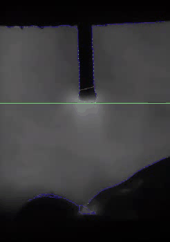
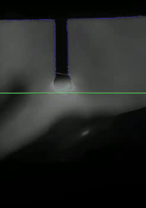
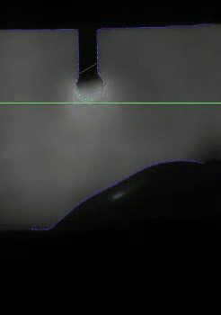
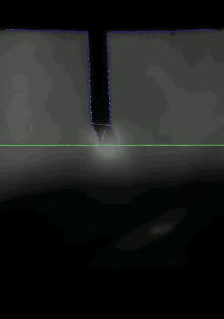

# Traditional Computer Vision for Welding Droplet Analysis

This module preserves the traditional computer-vision implementation developed for the analysis of droplet transfer in gas metal arc welding (GMAW).

The method uses image processing, custom contour tracing, and geometric analysis to estimate the upper and lower boundaries of the welding droplet region. It provides a classical computer-vision approach alongside the deep-learning methods included in this project.

> **Implementation status:** The original C++ implementation is preserved as an archived research artifact. The experimental results shown below are historical outputs generated using an earlier version of the implementation. The archived source code has not been fully validated in the current development environment.

## 1. Experimental Scope

Traditional vision experiments were conducted on four welding videos. The video identifiers, original filenames, frame counts, and manually inspected droplet transfer cycle counts are listed below.

| Video ID | Original video     | Total frames | Droplet transfer cycles |
|----------|--------------------|-------------:|------------------------:|
| 20       | `20_.avi`          |        3,000 |                      20 |
| 24c      | `24__clip.wmv`     |        1,036 |                      14 |
| 26c      | `26__clip.wmv`     |          737 |                       3 |
| 33       | `Y4 Camera33_.avi` |          300 |                       9 |

The droplet transfer cycle counts were determined through manual video inspection; they are not automatically estimated by the traditional-vision algorithm.

The traditional-vision experiments cover four of the seven videos included in the project's overall dataset. The other three videos (21, 22, and 29) are included in the deep-learning experiments but do not have corresponding traditional-vision results.

## 2. Algorithm Overview

The traditional-vision pipeline combines OpenCV image processing with custom pixel-level contour tracing.

The main processing stages are:

1. **Gaussian smoothing** — reduce local image noise before edge extraction.
2. **Edge extraction** — apply Canny edge detection to obtain an edge map.
3. **Region-of-interest masking** — suppress image content below a configured image row.
4. **Bright-contour processing** — identify contour fragments, filter unsuitable fragments, connect nearby gaps, and estimate local contour directions.
5. **Contour reconstruction** — extend contour traces, reconstruct contour representations, and process the resulting regions.
6. **Boundary estimation** — analyse the reconstructed contours to estimate two upper-boundary endpoints and the lower-boundary row.
7. **Result export** — save boundary coordinates in CSV format and generate visualizations.

The implementation uses a custom contour representation in addition to OpenCV's `findContours`. This representation stores contour fragments as ordered image-coordinate points and supports contour tracing, gap connection, local angle analysis, and endpoint extension.

## 3. Processing Pipeline

The main entry point is `main()`.

| Processing stage          | Main function or operation        | Purpose                                    |
|---------------------------|-----------------------------------|--------------------------------------------|
| Gaussian smoothing        | `GaussianBlur`                    | Reduce image noise                         |
| Edge extraction           | `Canny`                           | Extract edge structures                    |
| Lower-region masking      | `maskBelowRow`                    | Restrict the processing region             |
| Contour extraction        | `extractContourSegments`          | Extract custom contour segments            |
| Fragment filtering        | `filterContourSegments`           | Remove unsuitable contour fragments        |
| Gap connection            | `connectContourGaps`              | Connect selected nearby contour endpoints  |
| Direction analysis        | `calculateContourAngles`          | Calculate local contour directions         |
| Angle-change analysis     | `calculateAngleChanges`           | Analyse changes in contour direction       |
| Curvature-related marking | `markHighCurvaturePoints`         | Identify points with large angle changes   |
| Endpoint extension        | `extendContourFromEndpoints`      | Extend contour traces from their endpoints |
| Trace merging             | `mergeEndpointTraces`             | Merge traces generated from both endpoints |
| Contour reconstruction    | `findContours` and `drawContours` | Reconstruct and render contour regions     |
| Boundary estimation       | `trackDropletBoundary`            | Estimate droplet boundary coordinates      |
| Result export             | `imwrite` and CSV output          | Save visualizations and coordinate data    |

### Custom contour-processing strategy

The custom contour-processing routines implement several operations:

- **Contour extraction:** `traceContourStep` and `traceContourSegment` follow connected contour pixels and assemble contour segments.
- **Fragment filtering:** `filterContourSegments` removes fragments that do not satisfy the geometric criteria encoded in the implementation.
- **Gap connection:** `connectContourGaps` searches for nearby marker points and connects selected contour endpoints.
- **Direction estimation:** `calculateContourAngles` and `calculateAngleChanges` calculate local contour directions and their changes.
- **Endpoint extension:** `extendContourFromEndpoints` explores candidate continuation directions from both ends of contour segments.
- **Trace cleanup and merging:** `deduplicateTracePoints` removes repeated points, while `mergeEndpointTraces` combines traces generated from both endpoints.
- **Rendering:** `drawTrackedContours` draws the resulting tracked contour paths.

The `detectBrightContours` routine orchestrates the contour-processing stages, while `trackDropletBoundary` performs the final boundary estimation.

## 4. Boundary Estimation and Output

The traditional-vision method estimates three boundary components:

- The upper-left endpoint of the droplet region.
- The upper-right endpoint of the droplet region.
- The lower-boundary row coordinate.

The exported CSV files use the following schema:

| CSV field       | Description                                               |
|-----------------|-----------------------------------------------------------|
| `upper_left_x`  | X-coordinate of the upper-left boundary endpoint          |
| `upper_left_y`  | Y-coordinate of the upper-left boundary endpoint          |
| `upper_right_x` | X-coordinate of the upper-right boundary endpoint         |
| `upper_right_y` | Y-coordinate of the upper-right boundary endpoint         |
| `bottom_x`      | Not provided by the traditional-vision method; left empty |
| `bottom_y`      | Row coordinate of the estimated lower boundary            |

The lower boundary is represented by a row coordinate rather than a complete two-dimensional point. Therefore, `bottom_x` is intentionally left empty.

The boundary-estimation routine selects contour candidates based on their point counts and angle-change profiles. The upper boundary is derived from selected contour positions, while the lower boundary is estimated from the row coordinates of selected contour points.

## 5. Experimental Results

The following visualizations show the historical detection results for the four videos processed by the traditional-vision method.

Each detection GIF illustrates the estimated boundaries over the corresponding video frames. Boundary trajectory plots show how the estimated coordinates vary across the processed frames.

### 5.1 Video 20

Boundary trajectories:

- [Upper-left boundary](../data/results/traditional-vision/20/plots/upper_left.png)
- [Upper-right boundary](../data/results/traditional-vision/20/plots/upper_right.png)
- [Lower boundary](../data/results/traditional-vision/20/plots/bottom.png)

[Detection coordinates (CSV)](../data/results/traditional-vision/20/detection.csv)

### 5.2 Video 24c

Boundary trajectories:

- [Upper-left boundary](../data/results/traditional-vision/24c/plots/upper_left.png)
- [Upper-right boundary](../data/results/traditional-vision/24c/plots/upper_right.png)
- [Lower boundary](../data/results/traditional-vision/24c/plots/bottom.png)

[Detection coordinates (CSV)](../data/results/traditional-vision/24c/detection.csv)

### 5.3 Video 26c

Boundary trajectories:

- [Upper-left boundary](../data/results/traditional-vision/26c/plots/upper_left.png)
- [Upper-right boundary](../data/results/traditional-vision/26c/plots/upper_right.png)
- [Lower boundary](../data/results/traditional-vision/26c/plots/bottom.png)

[Detection coordinates (CSV)](../data/results/traditional-vision/26c/detection.csv)

### 5.4 Video 33

Boundary trajectories:

- [Upper-left boundary](../data/results/traditional-vision/33/plots/upper_left.png)
- [Upper-right boundary](../data/results/traditional-vision/33/plots/upper_right.png)
- [Lower boundary](../data/results/traditional-vision/33/plots/bottom.png)

[Detection coordinates (CSV)](../data/results/traditional-vision/33/detection.csv)

All result files are organized by method and video identifier under [`data/results/traditional-vision/`](../data/results/traditional-vision/). See [`data/README.md`](../data/README.md) for the overall data organization and additional dataset information.

## 6. Source Code and Original Implementation

The source code is provided in this directory:

- [`traditional_vision.cpp`](traditional_vision.cpp) — C++ implementation of the traditional image-processing and contour-tracing algorithm.
- [`run.bat`](run.bat) — original Windows execution script.

The implementation was developed using C++ and OpenCV. Its source includes OpenCV core, image-processing, image-codec, highgui, and geometry functionality.

The original implementation contains dataset-specific input paths, output paths, frame ranges, and processing parameters. It expects individual image frames as input rather than decoding video files directly.

### Original implementation requirements

The source was developed around the following environment requirements:

- C++17
- OpenCV
- A compatible C++ compiler

OpenCV 5.x compatibility was investigated during project maintenance, but the archived implementation has not been fully validated as an executable pipeline in the current environment. Consequently, the requirements above should not be interpreted as a verified build configuration.

## 7. Implementation Status and Limitations

Several limitations should be considered when interpreting this module:

- **Archived implementation:** The original C++ source is retained for algorithm inspection and research reference. It is not currently presented as a fully verified, end-to-end executable implementation.
- **Historical results:** The CSV files, GIFs, and plots shown in this README were generated using an earlier version of the implementation. They have not been reproduced from the archived source code in its present state.
- **Dataset-specific parameters:** Parameters such as the masking row, contour-connection radius, angle thresholds, and trace-length limits are embedded in the source and were developed around the characteristics of the original welding videos.
- **Intermediate markers:** The algorithm relies on colour-coded intermediate markers. Their values and processing conventions are part of the implementation.
- **Limited generalization:** The method has not been established as generalizable to arbitrary welding setups, camera configurations, illumination conditions, or droplet-transfer regimes.
- **No production claim:** This implementation is a research artifact, not a production-ready real-time detector.

These limitations distinguish the preservation of the original algorithm and its historical experimental outputs from a fully reproducible modern implementation.

## 8. Research Context

This module documents the classical computer-vision component of the welding droplet analysis project.

Its geometry-oriented approach uses edge extraction, contour tracing, local direction analysis, and boundary estimation. It complements the project's deep-learning experiments, which use CNN-based classification and regression to estimate droplet-region boundaries.

Together, the two approaches provide different methodological perspectives on the visual analysis of GMAW droplet transfer.
